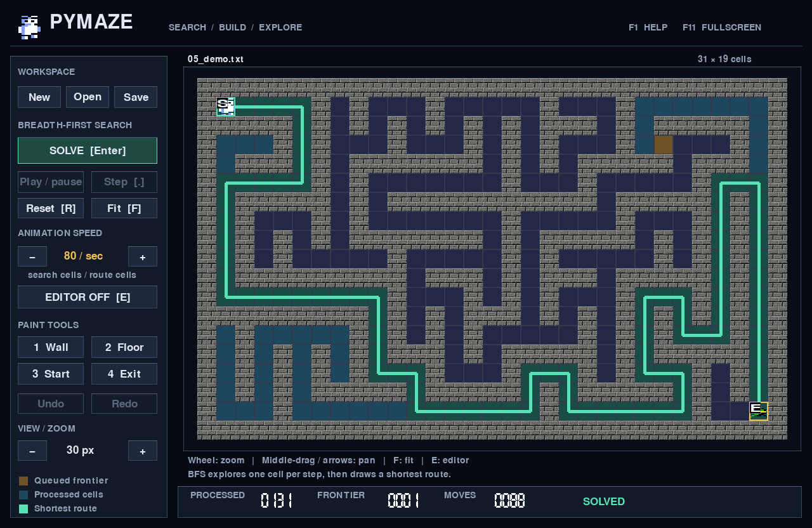

# PyMaze — animated solver and maze editor

An instructor reference solution for the Maze Solver project. The complete interface is drawn in **Pygame**, including the editor, file browser, forms, messages, and confirmation dialogs. The visual basis is Maciej Dems' **PyRobbo**: its original tile atlas and bitmap digits, a scaled logical window, a clipped/scrolled board, keyboard controls, and a bottom status display.

The application implements breadth-first search (BFS), animates the search and the resulting shortest route, and edits and saves the assignment's ASCII maze format. It runs locally and requires no network service.



## Install and run

Use Python **3.10 or later**. The implementation was verified with Python **3.12.14** and **Pygame 2.6.1**.

From the unpacked project directory:

```bash
python -m pip install -r requirements.txt
python main.py
```

On systems where the command is `python3`, substitute it for `python`. A virtual environment is recommended if your operating system manages Python packages:

```bash
python3 -m venv .venv
source .venv/bin/activate
python -m pip install -r requirements.txt
python main.py
```

Windows activation uses `.venv\Scripts\activate` instead of the `source` command. Pygame is the only third-party runtime dependency; no Tkinter, Qt, native file-dialog package, NumPy, PyYAML, or PyRobbo installation is needed.

Open a particular maze or start fullscreen:

```bash
python main.py mazes/03_cycle.txt
python main.py --fullscreen
```

Without a filename, `mazes/05_demo.txt` is loaded relative to the application files, independently of the current working directory. Use **Open** or **Ctrl+O** to select another file.

## Solver and animation

Press **Solve** or **Enter** to start a new search. The algorithm processes one queued cell per animation step, using a first-in, first-out queue. Neighbour order is up, right, down, left, so tied shortest routes are reproducible.

- **Gold floor cells** are discovered cells still in the queue: the frontier.
- **Blue floor cells** have already been processed.
- A gold outline marks the cell currently processed during search.
- Once the exit is reached, the **mint route** is revealed one cell at a time, with a moving PyRobbo sprite.
- The bitmap HUD shows processed cells, frontier size, and the route length in **moves**, excluding the starting cell.
- An unreachable exit produces **NO ROUTE EXISTS**, with no invented or partial solution.

The original maze is never modified by search or animation. `S`, `E`, and walls remain visible. BFS guarantees a shortest route because all allowed horizontal/vertical moves have equal cost. There is no diagonal movement or movement outside the rectangle.

Playback controls work through both phases, including the route reveal. Pacing is independent of display refresh: pausing, changing speed, or redrawing does not change the result. Event processing continues during solving; a bounded batch of search steps prevents a fast animation from monopolising the frame.

## Controls

| Action | Control |
| --- | --- |
| Start a fresh search / replay | **Enter** or **Solve** |
| Play / pause | **Space** or **Play / pause** |
| Advance one search cell or one route cell, then remain paused | **.** or **Step** |
| Clear search and route overlays, retaining the maze | **R** or **Reset** |
| Slower / faster animation | **− / +**, or the speed buttons |
| Toggle editor | **E** or **Editor** |
| Wall / corridor / start / exit tool | **1 / 2 / 3 / 4**, or the tool buttons |
| Paint selected tool | Left-click or left-drag |
| Erase to corridor, regardless of tool | Right-click or right-drag |
| Undo / redo editor stroke | **Ctrl+Z / Ctrl+Y** |
| Zoom | Mouse wheel over the maze, or zoom buttons |
| Pan a large maze | Middle-button drag, or arrow keys |
| Fit maze to the viewport | **F** or **Fit** |
| New maze with chosen width/height | **Ctrl+N** or **New** |
| Open a maze | **Ctrl+O** or **Open** |
| Save / save as | **Ctrl+S / Ctrl+Shift+S** |
| Toggle fullscreen | **F11** |
| Help | **F1** |
| Exit editor / cancel dialog | **Esc** |
| Quit outside editor | **Esc**, **Ctrl+Q**, or window close |

After a completed or unreachable search, **Step** does nothing; use Enter to replay. Space also starts a fresh replay when the previous run has finished. Reset clears search state, rather than reverting edits; editor undo is the way to reverse a painted stroke.

Dialogs pause playback. After closing a dialog, press Space to resume if desired. Losing window focus pauses the search and commits an active paint stroke, preventing a stuck brush. Mouse zoom retains the location under the pointer when the maze is larger than the viewport; small mazes remain centred.

## Maze editor

Enable **Editor**, choose a tool, and paint. Selecting a tool also enables the editor. Fast drags interpolate intermediate cells, and each complete mouse stroke is one undo action. The last **100** strokes are retained; redo is cleared after a new edit.

Placing `S` or `E` moves that marker: the previous location becomes a corridor. Painting a wall or erasing over a marker removes it. Incomplete mazes are allowed while editing; a red message identifies a missing endpoint. **Solve and Save validate the maze** and require exactly one start and exit. Invalid edits therefore cannot be written as a normal maze file or accidentally supplied to the solver.

Editing immediately discards the old frontier, processed set, and route. Undo and redo also discard stale search state. Save marks the current maze as the saved baseline; undoing all the way back to that state removes the unsaved indicator.

New mazes may have dimensions from **1 to 512 cells per side**. A wall border is created when both dimensions are at least 3; the first and last available corridor cells become endpoints when two are available. Tiny grids with only one initial corridor cell may start incomplete; paint another corridor and place the missing marker, or create a larger grid. A 1×1 maze cannot contain two distinct endpoints. Single-row and single-column mazes with at least two cells are supported.

Opening another file, creating a new maze, and quitting ask before discarding unsaved edits. Cancelling keeps the current maze. Resetting the search does not erase editor work.

## Pygame file browser and file safety

**Open** and **Save as** display an in-application file browser. Folders appear first, followed by `.txt` files. Double-click a folder to enter it or a file to open/select it, use **Up** to move to the parent directory, or type a full path into the field. Relative typed paths are interpreted relative to the displayed directory. A missing extension is completed with `.txt` when saving. Typing a full filename also permits opening files not listed by the `.txt` filter.

The path field supports Ctrl+A, Backspace/Delete, Home/End, and cursor movement. Clipboard paste uses Pygame's SDL clipboard when that backend supports it; ordinary typing is always available. Enter confirms the path; Esc cancels.

- Expected read/write/validation failures appear as messages without replacing a valid maze or clearing unsaved changes.
- Existing files are replaced only after the **Replace** confirmation. Enter in a confirmation defaults to **Cancel**; click Replace or press Y to accept.
- Confirmed replacement writes to a temporary sibling file and then replaces the target atomically. Creating a new file uses exclusive creation, so a newly appeared file is not silently overwritten.
- Only the ASCII maze is saved. Search markings and the solution line are display data.
- Invalid or incomplete mazes are validated before any write operation.

## ASCII format

| Character | Meaning |
| --- | --- |
| `#` | Wall |
| A normal space | Corridor |
| `S` | Start |
| `E` | Exit |

Rows must be nonempty and equally wide, with exactly one `S` and one `E`. No enclosing border is required. LF and CRLF line endings are accepted, as is a missing final newline. Leading and trailing spaces are preserved. Blank rows, tabs, `*`, non-ASCII characters, duplicate/missing endpoints, and inconsistent row widths are rejected.

Example:

```text
#########
#S     E#
#########
```

The shortest route is 6 moves. A no-route maze is valid and is reported as unsolvable, rather than rejected as malformed.

## Modules and headless use

| File | Responsibility |
| --- | --- |
| `main.py` | Command-line entry point; selects Pygame or ASCII mode |
| `maze.py` | Maze state, structural/endpoint validation, neighbour checks, editing, and independent snapshots |
| `solver.py` | Incremental BFS, predecessor links, and shortest-route reconstruction |
| `playback.py` | Search/route phases, pause, single-step, and animation pacing, without Pygame |
| `maze_io.py` | ASCII parsing, loading, safe saving, and text overlays |
| `app.py` | Pygame event loop, application actions, editor history, and file-dialog coordination |
| `view.py` | PyRobbo sprite/digit slicing, tiled rendering, viewport, zoom, and pan |
| `ui_widgets.py` | Pygame buttons, path/text fields, forms, file browser, and modal dialogs |
| `tests/` | Core checks and deterministic Pygame event workflows |

The model, solver, playback, and I/O modules do not import Pygame. To solve without opening a window:

```bash
python main.py --ascii mazes/03_cycle.txt
```

ASCII mode prints the original and solved mazes, marking corridor route cells with `*`. It needs only the standard library. This also works from another directory when an appropriate maze path is supplied.

The model can be used directly:

```python
from maze_io import load_maze
from solver import MazeSolver

maze = load_maze("mazes/03_cycle.txt")
route = MazeSolver(maze).solve()
print(len(route) - 1 if route is not None else "No route")
```

`route` is a list of `(row, column)` coordinates, including both endpoints, or `None` if no route exists. `MazeSolver.step()` processes one cell; `finished` distinguishes an unfinished search from a completed no-route result. The solver copies its input so later editing cannot alter a search in progress.

## Examples and verification

| File | Shortest route |
| --- | --- |
| `mazes/01_simple.txt` | 6 moves |
| `mazes/02_branches.txt` | 16 moves |
| `mazes/03_cycle.txt` | 18 moves |
| `mazes/04_no_solution.txt` | No route |
| `mazes/05_demo.txt` | 88 moves |
| `mazes/06_open_border.txt` | Open-boundary example with preserved trailing spaces |
| `mazes/07_single_row.txt` | 3 moves, no final newline |
| `mazes/08_single_column.txt` | 3 moves |
| `mazes/09_blocked.txt` | Additional no-route example with separated regions |

Run the optional reference-solution checks:

```bash
python -m unittest discover -s tests -v
```

There are **27 passing checks**. They cover shortest route length/validity, cycles/unreachable exits, one-dimensional/open-border mazes, CRLF and spaces, invalid input, independent state, exclusive/atomic file saving, animation phases, pause/speed independence, painting, undo/redo, endpoint movement, keyboard and mouse file browsing, incomplete mazes, bad dimensions, quit confirmation, failed saves, and large-viewport access. UI tests use actual Pygame events and rendering with SDL's **offscreen `dummy` video driver**; they do not open a desktop window.

The solved scene and file browser were also rendered and visually inspected. Native fullscreen behaviour, clipboard availability, and desktop-specific high-DPI scaling still depend on the user's SDL/window system and were not exercised on a physical display here. The included tests are verification of this reference implementation; student unit tests remain optional under the assignment.

## Practical limits and implementation choices

- The UI uses a **1280×832 logical canvas**, scaled by Pygame/SDL in a resizable window, following PyRobbo's logical-window approach. Sprite art uses nearest-neighbour scaling.
- Fit uses cells from 8 to 48 pixels; manual zoom permits 8 to 64. Very large mazes use pan because a cell is never shrunk below 8 pixels.
- The New dialog permits up to 512×512 cells. The parser does not impose this editor-creation limit on loaded files, but loading/search/snapshots remain limited by available memory.
- BFS uses time and memory proportional to the number of reachable/grid cells. Display drawing visits the visible cells, rather than drawing the whole world or scanning every route cell on each frame.
- Search and route reveal run at **1–2000 steps per second**. A step processes a queued cell or reveals a route cell; these are not claims about measured real-time throughput.
- Core data and undo records contain no display colours or solution markings. Search reset, editor undo, and loading are separate actions with explicit behaviour.

## Attribution and licence

This project adapts the UI ideas and small sprite/counter rendering routines from [Maciej Dems' PyRobbo](https://github.com/macdems/pyrobbo), reviewed at commit `f11b69edfb65b171792a76a259bcf7aab0abb6a4`. Its original default sprite atlas and bitmap digit strip are included. PyRobbo credits the GNU Robbo project for the graphics; no other PyRobbo artwork, levels, or sounds are included here.

See [CREDITS.md](CREDITS.md) for the specific reused pieces and [LICENSE](LICENSE) for the GNU GPL version 3 text. This adaptation is distributed under **GPL-3.0-or-later**, preserving the upstream attribution. No PyRobbo source repository is accessed at runtime.
